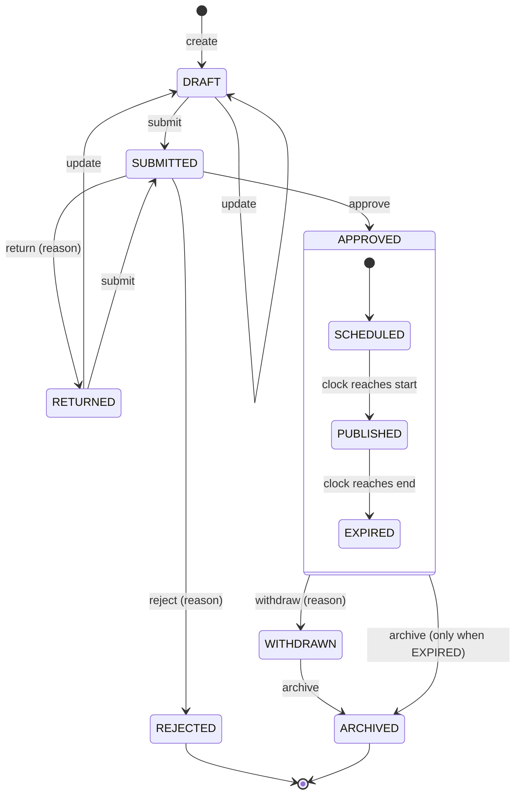

# Notice state machine

Source of truth: `server/src/modules/notices/stateMachine.js`. Controllers and
services call `applyTransition()`. Any action that is not in the table is
rejected with `409 INVALID_TRANSITION`.

## Stored workflow status

The database stores only statuses that change when a person acts:
DRAFT, SUBMITTED, RETURNED, REJECTED, APPROVED, WITHDRAWN, ARCHIVED.

| Action   | From                | To        | Roles                          | Guard / side effects |
|----------|---------------------|-----------|--------------------------------|----------------------|
| create   | -                   | DRAFT     | AUTHOR, ADMIN                  | author = current user |
| update   | DRAFT, RETURNED     | DRAFT     | owner (AUTHOR or ADMIN)        | If-Match version check; a RETURNED notice moves back to DRAFT and keeps its history |
| submit   | DRAFT, RETURNED     | SUBMITTED | owner (AUTHOR or ADMIN)        | full validation passes; no rejected attachments; submittedAt set |
| return   | SUBMITTED           | RETURNED  | REVIEWER, ADMIN                | reason (min 10 chars); not on own notice (ADMIN override audited) |
| reject   | SUBMITTED           | REJECTED  | REVIEWER, ADMIN                | reason required; terminal; not on own notice |
| approve  | SUBMITTED           | APPROVED  | REVIEWER, ADMIN                | creates the approved Revision; sets publication window, priority, pinned; emits NOTICE_PUBLISHED or NOTICE_SCHEDULED (and EVENT_CREATED for a linked event); not on own notice |
| withdraw | APPROVED            | WITHDRAWN | REVIEWER, ADMIN, owner AUTHOR  | reason required; an AUTHOR may withdraw only their own PUBLISHED notice; emits NOTICE_WITHDRAWN |
| archive  | WITHDRAWN, APPROVED | ARCHIVED  | REVIEWER, ADMIN                | APPROVED only if effective status is EXPIRED; emits NOTICE_ARCHIVED |

Extra action (not a status change): DELETE of a never-approved DRAFT/RETURNED
notice by its owner (see DECISIONS.md).

Corrections do not change the stored status. They create a PENDING revision
(`pendingRevision`), which a reviewer approves (NOTICE_CORRECTED) or rejects.

## Effective status (computed, never stored)

`getEffectiveStatus(notice, now)` in `visibility.js` returns the 10-state value
shown in the UI. For APPROVED notices:

- now < publicationStart -> SCHEDULED
- publicationStart <= now and (no end or now < publicationEnd) -> PUBLISHED
- publicationEnd exists and now >= publicationEnd -> EXPIRED

Every other stored status is returned unchanged.

