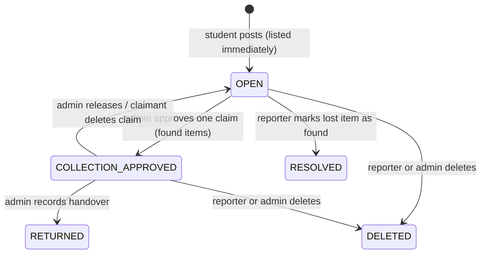

# Lost and Found module (Member 3 / C) - version 2

This module adds lost-and-found reports, claims on found items, admin
verification, recorded handovers and short on-screen notices to the shared KDU
UIDS application. It follows the repository conventions: CommonJS Express
modules, zod validation, the shared `AppError` error body, the audit log,
`withTransaction`, and the shared React UI components.

All sample items, descriptions and "evidence" are synthetic.

## Team decisions in version 2 (please review)

| Decision | Difference from the proposal / task sheet |
|---|---|
| **Reports are published immediately.** No admin review of lost/found reports. | The proposal and test T07 expected officer moderation before publication. T07 is replaced by the LF-REPORT tests. |
| **Only the ADMIN verifies claims.** There is no separate OFFICER role. | The proposal listed a separate lost-and-found officer. Nothing is added to the shared user roles. |
| **Claims only for FOUND items.** Lost items show "hand it in at the office" and, if the reporter allows it, their contact details. | - |
| **No date picker.** The posting date and time are set by the server. | - |
| **Students and the admin can delete reports and claims at any time** (after a confirmation box). Deleted records are hidden but kept for the audit log. | - |
| **Spam protection:** at most 10 reports per member per 24 hours (admins exempt). | Replaces pre-publication review as the abuse control. |

## Where the code is

| Area | Files |
|---|---|
| Backend module | `server/src/modules/lostFound/` |
| States and limits | `lostFound.constants.js` |
| Models | `item.model.js`, `claim.model.js`, `notice.model.js` (5-second notices), `caseEvent.model.js` (outbox), `counter.model.js` (references) |
| Business rules | `lostFound.service.js` |
| Field allowlists (privacy) | `lostFound.serializers.js` |
| Validation | `lostFound.schemas.js` |
| Photos | `lostFound.photos.js` (uses the shared attachment gateway) |
| Routes | `lostFound.routes.js` (mounted in `server/src/app.js`) |
| Retention cleanup | `lostFound.cleanup.js`, `server/scripts/lostFoundCleanup.js` (`npm run lf:cleanup -w server`) |
| Seed data | `lostFound.seed.js` (called from `server/src/seed/seed.js`) |
| Backend tests | `server/tests/lostFound.test.js` |
| Frontend API | `client/src/api/lostFound.js` |
| Student pages | `client/src/pages/lostFound/*` |
| Admin pages | `client/src/pages/adminLostFound/*` |
| Components | `client/src/components/lostFound/*` (`LfLayout` applies the module theme; `NoticeToaster` shows the 5-second notices; `DeleteButton` asks for confirmation) |
| Styles | `client/src/styles/lostFound.css` (scoped to `.lf-theme`), `client/src/styles/footer.css` |
| Frontend tests | `client/src/test/LostFound.test.jsx` |

## Roles

| Who | Can do |
|---|---|
| Anyone | Browse listed items and open item pages |
| Signed-in member (student) | Post lost/found reports, edit/delete own reports, mark own lost item as found, claim found items, delete own claims, see own cases in **My Cases** |
| `ADMIN` | Admin Dashboard: see every report, approve/reject claims, record handovers, release approvals, delete any report or claim. Admins do not post claims. |

## States

| Field | Values |
|---|---|
| `item.type` | `LOST`, `FOUND` |
| `item.status` | `OPEN` (listed), `COLLECTION_APPROVED` (listed as "Claim in progress"), `RETURNED` (handed over), `RESOLVED` (reporter marked lost item as found) |
| `item.deletedAt` | set when deleted (hidden everywhere, kept for audit) |
| `claim.status` | `PENDING`, `APPROVED`, `REJECTED` (shown to students); `WITHDRAWN` (internal: the claimant deleted a live claim) |

**Approval is not a return.** An approved claim reserves the item for one
student. Only "Record handover" makes the item `RETURNED`. After the handover
the student still sees "Approved", plus "You collected this item on ...".
Releasing an approval shows the claim to the student as "Rejected".

## Privacy rules

| Data | Public | Reporter | Claimant | Admin |
|---|---|---|---|---|
| Title, description, category, location, posted date, photos, where it is now | yes (while listed) | yes | item summary | yes |
| Contact details | only if the reporter chose **Everyone** | yes | no | yes |
| Private details (lost items only) | no | yes | no | yes |
| Reporter identity | no | self | no | yes |
| Claim proof and claimant identity | no | **no** (only a claim count) | own claim only | yes |
| Who collected the item | no | no | no | yes |

* Deleted, returned or resolved items return **404** from public routes, the
  same as a missing item.
* Another member's report or claim returns **404**, not 403.
* Losing claimants are told "This item was returned to its owner", never who.
* Notices and case events contain no proof, private details or contact details.

## Why two people cannot both collect the same item

1. Approving a claim first runs an **atomic conditional update** on the item:
   `{ status: 'OPEN', activeClaim: null }` becomes
   `{ status: 'COLLECTION_APPROVED', activeClaim: claimId }`. If two admins approve
   two claims at the same moment, only one update matches; the other gets
   **409 COLLECTION_ALREADY_APPROVED**.
2. Item and claim updates run in a **MongoDB transaction** (replica set).
3. A **partial unique index** `lf_one_collector_per_item` allows at most one
   `APPROVED` claim per item, even if code bypasses the service.
4. **Handover** only matches an item whose `activeClaim` is this claim. A
   repeated request gets **409 ALREADY_HANDED_OVER**; one handover record only.
5. `lf_one_active_claim_per_member` stops repeated claims by the same student.

Without a replica set the approval code releases the slot it took if the claim
update fails, and the unique index still blocks a second collector.

## API

Responses: `{ data }` or `{ data, meta }`; errors
`{ error: { code, message, details, requestId } }`.

### Public

| Method | Path |
|---|---|
| GET | `/api/public/lost-found/items?q=&type=&category=&page=&limit=` |
| GET | `/api/public/lost-found/items/:id` |
| GET | `/api/public/lost-found/items/:id/photos/:photoId` |

### Members

| Method | Path | Notes |
|---|---|---|
| POST | `/api/lost-found/items` | `{ type, title, description, category, location, custodyNote?, contactDetails?, contactVisibility: ADMIN \| EVERYONE, privateDetails? }`. No date field. 429 `DAILY_LIMIT` after 10 per 24 h. |
| GET | `/api/lost-found/me/items?type=` | own reports |
| GET | `/api/lost-found/me/items/:id` | includes `claimCount` |
| PATCH | `/api/lost-found/me/items/:id` | `If-Match: <version>` |
| POST | `/api/lost-found/me/items/:id/resolve` | lost items: mark as found |
| DELETE | `/api/lost-found/me/items/:id` | rejects open claims and notifies them |
| POST / DELETE | `/api/lost-found/me/items/:id/photos[/:photoId]` | JPG/PNG, 5 MB, max 3 |
| GET | `/api/lost-found/items/:id/photos/:photoId` | reporter or admin |
| POST | `/api/lost-found/items/:id/claims` | `{ evidenceText }`, found items only |
| GET | `/api/lost-found/me/claims`, `/api/lost-found/me/claims/:id` | own claims |
| DELETE | `/api/lost-found/me/claims/:id` | any time |
| GET | `/api/lost-found/me/notices` | unseen notices, each returned once |

### Admin

| Method | Path | Notes |
|---|---|---|
| GET | `/api/lost-found/admin/stats` | `actionNeeded { lostItems, foundItems, claimsWaiting }`, `byCategory`, `longestFound`, `longestLost` |
| GET | `/api/lost-found/admin/items?type=&category=&status=` | all non-deleted reports, `meta.typeCounts` |
| GET | `/api/lost-found/admin/items/:id` | full report + all claims |
| DELETE | `/api/lost-found/admin/items/:id` | |
| GET | `/api/lost-found/admin/claims?status=ALL\|PENDING\|APPROVED\|REJECTED` | grouped by item, `meta.tabs` counts |
| POST | `/api/lost-found/admin/claims/:id/decision` | `{ decision: APPROVE \| REJECT, note? }` |
| POST | `/api/lost-found/admin/claims/:id/release` | `{ note }` |
| POST | `/api/lost-found/admin/claims/:id/handover` | `{ identityChecked: true, recipientName, note? }` |
| DELETE | `/api/lost-found/admin/claims/:id` | |
| GET | `/api/lost-found/admin/case-events` | outbox for Member 4 |

## Notices and events

* **5-second notices** (`lostfoundnotices`): created when a claim is approved,
  rejected, released, or auto-rejected (item returned to someone else or report
  deleted). `NoticeToaster` checks on every page change and every 30 seconds and
  shows each notice once for 5 seconds.
* **Case events** (`lostfoundcaseevents`): same envelope as Member 2's domain
  events (`eventId` uuid v5, `idempotencyKey`, `recipients`,
  `deliveryStatus: PENDING`). Member 4's notification inbox can consume these
  and replace the simple notices later.

## Pages

| Route | Who | Page |
|---|---|---|
| `/lost-found` | everyone | centered banner, search, My Cases / Report an item (students) or Admin Dashboard (admin), All / Found Items / Lost Items with count, categories |
| `/lost-found/items/:id` | everyone | item page; **Claim** form for students on open found items |
| `/lost-found/report` | members | report form |
| `/lost-found/my-cases` | members | My Reports (All / Lost / Found) and My Claims |
| `/lost-found/my-reports/:id`, `/edit` | reporter | report detail, photos, edit, mark as found, delete |
| `/lost-found/my-claims/:id` | claimant | admin decision, proof, delete |
| `/admin/lost-found` | admin | Action Needed (Lost Items, Found Items, Claims Waiting), Show all items, categories, held longest |
| `/admin/lost-found/items` | admin | report list with type tabs and category filter |
| `/admin/lost-found/items/:id` | admin | full report, claims with Approve / Reject / Record handover / Release / Delete |
| `/admin/lost-found/claims` | admin | tabs All / Pending / Approved / Rejected, grouped by item |

## Seeded data

`npm run seed` adds students `student1@kdu-uids.test` and
`student2@kdu-uids.test` (password `Student@12345`); the admin is
`admin@kdu-uids.test` / `Admin@12345`. Eight items: a found umbrella with two
pending claims, a water bottle with public contact, a lost card holder, a recent
earbuds case, lost keys, a hoodie with an approved claim waiting for handover
(and one rejected claim), a returned calculator, and a lost backpack marked as
found.

## Demonstration script

1. `npm run seed`, `npm run dev`, open http://localhost:5173/lost-found.
2. As **student1**: *Report an item* -> Found -> fill in, choose contact
   "Everyone". It is listed immediately with the date added automatically.
3. As **student2** (another browser): open the item -> **Claim** with proof.
4. As **admin**: *Admin Dashboard* -> *Claims Waiting* -> open the item -> read
   the proof -> **Approve**. The claim moves to *Approved*; the public card shows
   *Claim in progress*.
5. As **student2**: a 5-second notice says the claim was approved.
6. As **admin**: **Record handover**, tick the card check. The item is returned
   and leaves the public list; other claims are rejected with a notice.
7. Explain why two people cannot both collect (section above) and show test
   LF-CLAIM-3.
8. Shortcut: the seeded *Grey hooded sweatshirt* is already approved, so the
   admin can record its handover straight away.

## Tests

Backend (`npm run test:server`, needs the in-memory MongoDB download):

| ID | What it proves |
|---|---|
| LF-REPORT-1..7 | immediate listing, unique references, automatic date; found items store no private details; contact shown only for EVERYONE; own edit/delete only; mark lost as found; daily limit; My Reports filter |
| LF-CLAIM-1..10 | found-only claims; no self/admin/duplicate claims; admin-only verification; two simultaneous approvals -> one wins; DB index; approval is not a return; one handover; release; evidence privacy; delete rules for claims and reports |
| LF-NOTICE-1 | approve/reject notices, shown once, only to the claimant |
| LF-ADMIN-1..3 | dashboard counts, grouped claims with tab counts, list filters |
| LF-PHOTO-1..2 | photo visibility and upload validation |
| LF-RETENTION-1 | evidence cleanup keeps history |

Frontend (`npm run test:client`): FE-LF-1..7.

## Shared files changed (outside the module)

| File | Change |
|---|---|
| `server/src/app.js` | mounts `/api/public/lost-found` and `/api/lost-found` |
| `server/src/seed/seed.js`, `seed/fixtures/accounts.js` | calls the lost-found seed; adds student1 and student2 |
| `server/tests/helpers/testDb.js` | registers lost-found models |
| `server/package.json` | `lf:cleanup` script |
| `client/src/App.jsx` | routes inside `LfLayout`; mounts `NoticeToaster` |
| `client/src/components/layout/NavBar.jsx` | one **Lost & Found** link |
| `client/src/components/layout/Footer.jsx` + `styles/footer.css` + `assets/kdu-logo.png` | blue footer with campus addresses and the KDU logo on a white badge (affects every page) |
| `client/src/main.jsx` | imports `lostFound.css` |

## Known gaps / integration work

* **Member 1:** real login replaces the temporary one; this module only needs
  `req.user` with `_id` and `role`. Photos already use the attachment gateway.
* **Member 4:** consume `/api/public/lost-found/*` in unified search; deliver
  `lostfoundcaseevents` and replace the simple notices with the inbox.
* **Leader:** confirm the footer text (the KDU Global postcode is shown as
  "2476", exactly as provided) and that removing the sample-data notice from the
  footer is acceptable.
